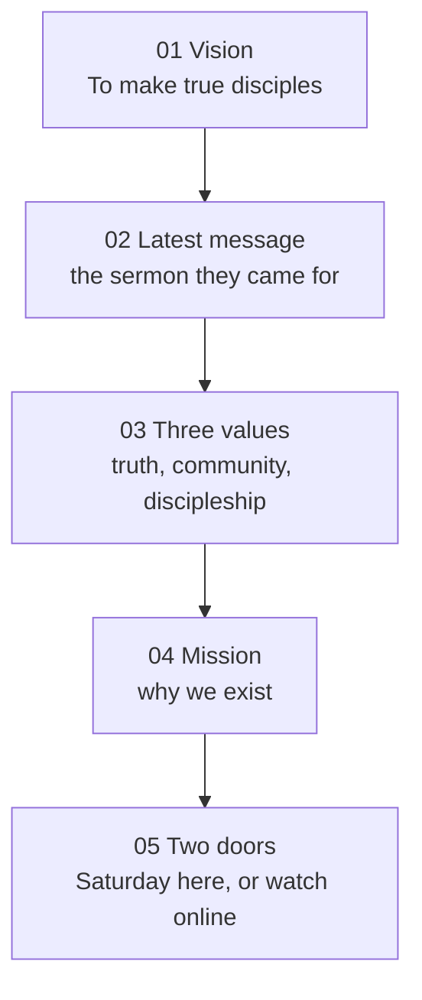

# Direction from Leadership

What the homepage should say, and in what order, after the pastors' review.

This replaces the opening of `docs/HOMEPAGE-EXPERIENCE.md`. That document opens on a dark photograph and the line "There's a place for you here." The pastors want the first screen to do what [2819 Church](https://2819church.org/) does: a white page, the vision in huge type, the gathering time beside it, and two ways in. The words are ours, from the 2026 Leadership Alignment Guide. The motion already on phones stays: Ink & Brush, cards, the paper swipe.

2819 is a pattern, not a skin to copy. We do not take their claim, their Sunday schedule, their photography, or their megachurch scale. Clairemont is a Sabbath congregation on Hathaway Street. The site should feel like that church, said clearly.

---

## 1. The first sentence

The first thing a visitor reads is the vision:

> To make true disciples.

On 2819 that slot is "Until all have heard." On ours it is this line, set the same way: enormous, black, with one word in red. Under it, one sentence from the guide, not a paragraph:

> A church where people move beyond simply attending to becoming committed followers of Jesus.

Service times sit above the headline, the way 2819 puts "Sunday Gatherings" above its vision. A visitor who came because we are the closest church should see when we meet before they scroll.

Two actions sit under the line, in this order:

1. **Plan your visit** — for the person who searched and is deciding whether to come Saturday.
2. **Watch the latest message** — for the person who came to be fed. The pastors were direct: most people arrive for the message, so last week's sermon is on the first screen, not buried under a building photo.

The church exterior stops being the hero. It can appear later, smaller, as proof of the place. It does not lead.

---

## 2. The words, as written

These are transcribed from the Leadership Alignment Guide, page 2, "Who we are and why we exist." The homepage uses the short line. The About page uses the paragraph. Nothing here is rewritten for tone.

### Scripture first

Clairemont SDA Church is grounded in the Word of God and the biblical beliefs of the Seventh-day Adventist Church. Scripture determines what we believe, shapes who we are, and directs how we participate in Christ's mission.

Our leadership, ministries, priorities, and decisions should flow from this foundation.

The three texts named on the guide:

| Text               | What the guide calls it                                              |
| ------------------ | -------------------------------------------------------------------- |
| Matthew 28:18–20   | The Great Commission                                                 |
| Acts 1:8           | Witnesses in Jerusalem, Judea, Samaria, and to the ends of the earth |
| Revelation 14:6–12 | The Everlasting Gospel and the Three Angels' Messages                |

### Three values

The guide introduces them this way: through our leadership process, we identified three values that describe the culture we want to intentionally develop at Clairemont.

| Value                     | Short line, for the homepage                                      | Full line, for About                                                                                              |
| ------------------------- | ----------------------------------------------------------------- | ----------------------------------------------------------------------------------------------------------------- |
| Biblical truth            | We are shaped by and committed to God's Word.                     | Scripture guides our teaching, preaching, decisions, discipleship, and daily lives.                               |
| Authentic community       | We intentionally build meaningful, Christ-centered relationships. | Relationships where people are known, supported, encouraged, and given a place to belong.                         |
| Generational discipleship | We intentionally develop disciples across every generation.       | Children, youth, young adults, adults, families, and new believers, equipped to follow Jesus and disciple others. |

The banner under the three: **Our values describe who we are and how we live.**

Biblical truth is the one the pastors said people already come for. Generational discipleship is the one they said is still thin: the church has been strong at going out, and people inside still leave because they are not being guided. The site says all three. It does not pretend the third is finished.

### Mission — why we exist

> We exist to lead people to Christ through biblical truth, to loving God, loving others, making disciples, and preparing the world for His soon coming.

The guide's own gloss, for About and not for the hero: the church exists for more than maintaining programs or filling a calendar. Everything we do should contribute to reaching people, developing disciples, and advancing Christ's mission.

### Vision — who we are becoming

> To make true disciples.

The guide's own gloss: true disciples are growing in biblical truth, experiencing authentic community, serving others, developing the next generation, sharing their faith, and helping others become disciples of Christ.

### The order the guide already uses

Scripture and beliefs, then values, then mission, then vision. The homepage inverts the last two on purpose, the way 2819 does: the vision is the door, the mission is the next sentence, the values are the proof, and beliefs are a page you open when you want them.

The cover line of the retreat series, **One church. One direction.**, can close the values block. It is a leadership phrase. It is not the hero.

These statements were agreed by leaders and had not yet been shown to the congregation when the guide was made. Putting them on the public site is the pastors' request. It is how the church meets its own language.

---

## 3. What we take from 2819

What is worth taking is the sequence and the amount of white, not the layout details.

| Theirs                                     | Ours                                                                                    |
| ------------------------------------------ | --------------------------------------------------------------------------------------- |
| White page, black type, one red            | Same palette we already have: paper, ink, dawn. Full-bleed black sections stop leading. |
| Vision fills the first screen              | "To make true disciples."                                                               |
| Gathering time above the vision            | Sabbath School 9:30 AM, Divine Worship 10:45 AM                                         |
| Plan your visit, then join online          | Plan your visit, then watch the latest message                                          |
| Mission one screen later, two words in red | "We exist to lead people to Christ…" with "biblical truth" in red                       |
| In person and online as two doors          | The same two doors, at our scale: Saturday on Hathaway, and the sermon on demand        |
| Values and beliefs on About                | Values on the homepage in three short lines. Beliefs on their own page.                 |

What we do not take: their photography, their type treatment of letterspaced lowercase, their growth-track and squads language, or a claim about size. "Join a discipleship group" is the Clairemont name for the thing they call a growth track.

The pastors also asked for the practical visit questions 2819 answers in plain words: what should I wear, where do I go, what is the gathering like, where is Sabbath School. Those live on `/visit`, linked from the first screen. They are not new pages.

---

## 4. Homepage, top to bottom

Five chapters. A phone visitor who never opens the menu should leave knowing who we are, when we meet, and what to do next. The pastors' estimate was that this scroll is 60 to 70 percent of what most people will ever see, and that well over 90 percent of them are on a phone.

### 01 — Vision

White. Times across the top. The vision at display size. The one-sentence gloss. Plan your visit. Watch the latest message, pointing at the sermon in the next chapter.

On a phone this is the first card of the stack. The paper edge of the next card is visible at the bottom, so the swipe is an invitation rather than a surprise.

### 02 — Latest message

Sermon title, speaker, date, and one way to play it. A still from the message, not the building. A link to the full archive at `/watch`.

When no sermon is published, the card falls back to the standing service times and "Watch online," the way This Sabbath already falls back today. The chapter never disappears.

### 03 — Three values

Three marks in a row on desktop, three beats on a phone. Each is the name plus the short line from the table above. Biblical truth, authentic community, generational discipleship. Under them, the banner: our values describe who we are and how we live.

On a phone, each value can be its own paper card, using the swipe the pastors already liked. Tapping a value opens About, anchored to that value.

### 04 — Mission

The mission sentence, large, with "biblical truth" in red. One line of the gloss. A text link: more about us, to `/about`.

Matthew 28:18–20 can sit beside it in Newsreader, as the scripture the vision comes from. Acts 1:8 and Revelation 14:6–12 stay on About, so the homepage does not become the guide.

### 05 — Two doors

**In person.** Sabbath times, Hathaway Street, what to wear and where to park as a single link to `/visit`.

**Online.** Watch the latest message, and a way to subscribe to the channel. The pastors were clear that people already gather digitally and the site currently offers them nothing. This door is that offer, at the size we can keep today: the sermon and the livestream, not a second church.

A parent looking for Sabbath School finds it from Plan your visit and from Ministries. It does not need a sixth homepage chapter.

---

## 5. Where each idea lives

One page per idea, matching `docs/INFORMATION-ARCHITECTURE.md`.

| Idea                    | Homepage                             | Full page                                                                          |
| ----------------------- | ------------------------------------ | ---------------------------------------------------------------------------------- |
| Vision                  | The hero                             | Repeated at the top of `/about`                                                    |
| Latest sermon           | Chapter 02                           | `/watch` and `/this-sabbath`                                                       |
| Three values            | Names and short lines                | `/about`, with the full paragraphs                                                 |
| Mission                 | One sentence                         | `/about`                                                                           |
| Scripture as foundation | Matthew 28 only                      | `/about`, then `/about/beliefs`                                                    |
| Plan a visit            | Button                               | `/visit`: what to wear, where to park, what the morning is like, where children go |
| Digital congregation    | Button                               | `/watch`                                                                           |
| Discipleship group      | Named inside the third value, linked | `/ministries/care-group` until a discipleship page exists                          |
| 28 fundamental beliefs  | Not on the homepage                  | `/about/beliefs`, later as swipeable cards, one belief at a time                   |
| Leadership              | Not on the homepage                  | `/about/leadership`                                                                |

The beliefs interaction the pastors liked — the same paper swipe, one belief per card — is a later pass on `/about/beliefs`. They had not chosen between all 28 fundamentals and a shorter set. The homepage does not wait on that choice.

---

## 6. Visual direction

Follow page 2 of the guide and the amount of white on 2819.

- **Paper** is the page. **Ink** is the type. **Dawn** is the single red, used the way the guide uses it: one word in a headline, a rule, a mark. Not a full-bleed field.
- **Ink & Brush stays on phones.** Torn paper edges, the card stack, the brush underline, the dock. The pastors chose this over 2819's own phone page, and over Golden Hour.
- **Golden Hour comes off the homepage.** It is the dark theme they said there was too much of. The theme toggle can remain in the branch until this lighter Ink & Brush is in review. It is not the version we show them.
- **Desktop stays structured**, in this new order, on white. The paper stack is a phone behavior. A wide screen keeps the editorial grid.
- **Type stays ours.** Oswald for the vision and the value names. Newsreader for the scripture and the gloss. The guide's brush script is reserved for a short accent, the way the sermon slides use it, not for sentences.
- **The logo is not ready.** The retreat cover's "C" and cross is a sketch in a lockup, and the pastors said the logo studies are still too much. The site keeps the Clairemont wordmark until a vector lockup is approved. Branding gets one careful pass later. It does not block this homepage.

---

## 7. What this pass does not do

- Rebuild every interior page. About and Plan your visit change because the homepage now promises them. Ministries, events, prophecy, and giving keep their current layouts.
- Invent a digital membership, a growth track, or a prayer-routing team. Prayer stays one inbox. An automatic reply and a count for the team can follow once the door exists.
- Lead with "come as you are" or with coffee and dress code. Welcome is real, and it is said inside Plan your visit. The first sentence is the vision.
- Put the old mission from `docs/PRODUCT-VISION.md` back on the hero. That paragraph and the tagline "Developing a loving relationship with Christ and our community." stay in the record. The guide's sentences are the ones the pastors asked to publish.

---

## 8. How the pastors compare

The homepage carries a review switch: **Paper**, **Ink & Brush**, **Poster**, and **Current**. The words do not change between the three new designs. The dress does.

- **Paper** is our editorial page. White, hairlines, the dawn tick, Oswald and Newsreader. On a phone the chapters still peel as paper.
- **Ink & Brush** is the same chapters with the sermon-slide voice: a brush underline, hard black borders, the values band moving across the first screen.
- **Poster** is the full-screen composition the pastors pointed at on 2819: the vision in huge type, photographs set into the words, gathering times and two ways in along the bottom. The frame inside the sentence is our latest message, and it plays on the page. Oswald and dawn stay ours. Their claim, their Sunday schedule, and their photography do not.
- **Current** is the homepage as it stands, so the new pages have something to be judged against.

The choice is remembered on the device. `?design=ink`, `?design=poster`, and `?design=current` open a specific one. This switch is for the review. It is not a visitor control, and it comes off once a design is chosen.

About, Plan your visit, and the beliefs cards are the next stage. They wait until the homepage design is chosen.

---

## 9. Build order

1. Homepage, done for review. Paper and Ink & Brush, same five chapters, switchable with Current.
2. About. The full value paragraphs and the mission gloss from section 2.
3. Plan your visit. What to wear, what the morning is like, where Sabbath School meets, where to park.
4. Beliefs as swipeable cards, after the pastors have chosen a homepage design.
