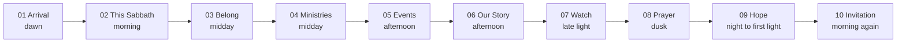

# Homepage Experience, Scene by Scene

Ten chapters, designed as one continuous narrative rather than ten content blocks. Nothing here is implemented yet — this is the specification that Phase 3 builds against.

The unifying device is **an arc of light**. The page opens at dawn, moves through full daylight, darkens as it turns toward prayer, and returns to morning at the invitation. A single scroll listener (`<ChapterAtmosphere>`) writes `--light-warmth`, `--light-position`, and `--register` to the document root; each chapter interpolates its own background from those properties in CSS. This costs one listener and no per-chapter JavaScript, and it is why the page feels like one place rather than ten sections.

Sundown is when the Sabbath begins and ends in Adventist practice, so the arc is the congregation's own rhythm rather than a decorative gradient.



Each chapter is labeled with an `eyebrow` numeral and name (`01 — ARRIVAL`), borrowed from the journal concept. The numbering is what turns scrolling into reading.

---

## 01 — Arrival

**What the visitor sees.** A full-height (`100dvh`) scene. A warm morning sky occupies the upper two-thirds — layered gradients from `sky-300` through `sky-100` into a `dawn-soft` wash near the horizon, with two very soft cloud textures at low opacity. Beneath and overlapping it, a single photographic plate: the congregation, or the church entrance in morning light, cropped so there is quiet space for type. Over it, in Newsreader at `display-1`, weight 300:

> There's a place for you here.

Below, in `body-lg`: **San Diego Clairemont Seventh-day Adventist Church**. Then a hairline rule, and the service times set in tabular numerals with the eyebrow label `SATURDAYS` — Bible Study 9:30 AM · Worship 10:45 AM — followed by the street address as a link to directions. Two actions: **Plan Your Visit** (solid `ink`) and **Watch Online** (hairline outline). At the base, a small `dawn` hairline and the label `01 — ARRIVAL` with a subtle descending indicator.

Deliberately absent: no logo lockup floating over the photo, no scrim of gradient darkening the whole image, no autoplaying video, no animated headline. The headline is present at first paint because it is the LCP element.

**On scroll.** The sky layer translates up 8% of viewport height while the photographic plate translates 2% and scale-drifts 1.00 → 1.04, so the sky recedes and the photograph advances — parallax used to place the viewer in a space rather than to decorate. The headline block translates up 4% and fades to 0 opacity over the last 40% of the section, so the type dissolves into light as the next chapter arrives. Clouds gain a small additional vertical offset within the 12% budget.

**On pointer movement.** Spring-smoothed displacement, mapped from pointer position within the section only: far cloud layer up to 14px, near cloud layer up to 8px, photographic plate up to 4px, type layer 0. The type never moves — moving text under a cursor is the fastest way to make a page feel like a toy. The total effect is roughly a fingernail's width of relative shift: depth felt before it is noticed. Enabled only under `(hover: hover) and (pointer: fine)`; values flow through `MotionValue`s so no React render occurs on pointer move.

**Mobile.** Pointer parallax removed entirely. One cloud layer instead of two. Scroll parallax reduced to 4%. The photographic plate takes a portrait crop via Sanity's hotspot, so faces stay centered. Headline drops to the low end of the `display-1` clamp; service times and address get more vertical room, since a phone visitor is often standing outside the building. `100dvh` avoids the browser-chrome crop.

**Reduced motion.** A still, composed frame: sky, clouds, and photograph at their mid-scroll resting positions — the version we would choose if this were a printed page. No drift, no fade-out on scroll, no observers registered.

**Implementation.** `<AtmosphericBackground>` (CSS gradients + `--light-*` properties) containing `<CloudParallax>` (2 layers) and `<ParallaxMedia>`, all inside one `<PointerParallax>` client wrapper. The heading, times, and CTAs are server-rendered `children` passed through the wrapper — the wrapper hydrates, the content does not.

**Performance.** The hero photograph is the LCP: `priority`, `fetchPriority="high"`, AVIF/WebP via Sanity, under 250KB, with explicit dimensions and an LQIP blur. Cloud textures are small and cached. Three or four promoted compositing layers, counted and capped. `will-change` applied on mount and released after the section leaves the viewport. Nothing in this chapter animates on entrance, so there is no first-paint cost to the motion system at all.

---

## 02 — This Sabbath

**What the visitor sees.** The register shifts to full morning: `paper` background, the sky washing out to nothing at the top edge. `02 — THIS SABBATH`, then the date in `heading-1` ("Sabbath, August 29"). An asymmetric two-column layout on the grid: columns 2–7 hold the sermon title in Newsreader `heading-1`, the speaker's name and role beneath, then the scripture in Newsreader italic at `quote` size with the reference in `eyebrow` below it, then a two-or-three-sentence sermon summary. Columns 8–11 hold a portrait-crop photograph of the speaker or the sanctuary, with the two times as a small hairline-separated table beneath it, plus links to the bulletin PDF and the livestream when present. A tertiary link: _See the full program_.

This is the chapter members come for, so it is second, above everything atmospheric, and it is scannable in three seconds.

**On scroll.** Restrained by design. The text column reveals in two groups (title/speaker, then scripture/summary) with a 60ms stagger. The photograph reveals with a slight scale drift, 1.00 → 1.03, across the section. That is all — a chapter carrying practical information should not make the reader wait for it.

**On pointer movement.** None. Correctly none. The links have quick 120ms underline transitions and nothing else.

**Mobile.** Single column, stacked: date, sermon title, speaker, scripture, photograph, times, links. The times move above the photograph, because a member checking their phone on Friday night wants the time before the picture.

**Reduced motion.** Fully rendered, no reveal. No visual difference from the final state.

**Implementation.** A Server Component receiving the resolved `sabbathProgram`. The "appropriate upcoming Sabbath" is chosen in GROQ — first program with `date >= today` ascending, falling back to the most recent past program so the section never renders empty when staff are behind. Date comparison and all formatting run in `America/Los_Angeles` via `src/lib/sabbath.ts`, because a UTC comparison flips on Saturday afternoon and would show next week's program during the service. Wrapped in `<Reveal>`. If no program exists at all, the chapter degrades to service times and address from `siteSettings` rather than disappearing.

**Performance.** No client JavaScript beyond the `<Reveal>` wrapper. Statically generated, revalidated by webhook when staff publish.

---

## 03 — Belong

**What the visitor sees.** The emotional center of the visitor's journey and the answer to their real question, which is not "what do you believe" but "will I be alone there." `03 — BELONG`, a short headline ("Come as you are. Stay as long as you like."), and a brief paragraph in first person.

Then three photographic plates at different sizes, deliberately un-gridded — overlapping, offset vertically, breaking the container on one side. People talking after service, an older member with a child, someone laughing. Each carries a real caption in `body-sm`. Beside the second plate, a member testimonial: a real quote in Newsreader italic with a name and how long they have attended.

Captions naming real people are what make this chapter work. Uncaptioned photos read as stock; "Marisol and Elena after Sabbath School" reads as a place that exists.

**On scroll.** The three plates translate at different rates within the 6% foreground budget — the offset plate slowest, the outer plates faster — so the group breathes as it passes rather than moving as one board. Each plate reveals with opacity plus 16px on first entry, staggered 80ms. The testimonial reveals as lines with a 50ms stagger, the only `<RevealText>` use in this chapter.

**On pointer movement.** A single restrained effect: hovering a plate warms it slightly (a `dawn-soft` overlay from 0 to 6% opacity over 200ms) and reveals its caption from 70% to 100% opacity. No lift, no scale, no shadow. Keyboard focus produces the identical state, since the plates are focusable links into `/gallery`.

**Mobile.** Plates stack full-bleed edge to edge with captions beneath, alternating left and right alignment to keep rhythm. Parallax reduced to a 3% differential between adjacent plates. Captions always visible rather than hover-revealed.

**Reduced motion.** Plates at resting offsets, captions visible, no reveal, hover overlay becomes an instant state change.

**Implementation.** `<Reveal>` per plate with staggered delays, `<ParallaxMedia>` per plate with per-plate rate props, `<RevealText>` on the testimonial. Content from `homePage.belong` plus referenced `testimonial` documents.

**Performance.** Three images at plate budget (under 180KB each), all lazy-loaded, all with explicit dimensions. Three scroll-linked transforms in one observer-gated scene.

---

## 04 — Ministries

**What the visitor sees.** The chapter with the most interaction, and explicitly not a grid of cards. Full-viewport, split composition. The left half (columns 1–5) is a vertical list of five ministry names set large in Newsreader `display-2`, one per line:

```
PATHFINDERS
ADVENTURERS
SABBATH SCHOOL
CARE GROUP
VACATION BIBLE SCHOOL
```

The right half is a single large photographic plate. Beneath the active name: its one-sentence description, age range, and meeting schedule, in `body`. On arrival the first ministry is active, so the chapter is never in an empty state.

**On pointer movement.** Hovering or focusing a name makes it active. Three things change together over `--dur-slow` with `--ease-gentle`: the photographic plate cross-fades to that ministry's `switcherImage` (opacity only — two stacked images, the outgoing one fading out, never a `filter` or `width` transition); the supporting text cross-fades and shifts 8px; and the section's ambient temperature shifts toward that ministry's `accentTone`, warming for Pathfinders, greening for Adventurers, cooling for CARE Group. Inactive names sit at `ink-45`; the active one is `ink` with a `dawn` hairline extending from the left over 200ms.

Additionally, within the plate, a small pointer parallax of up to 6px, so the photograph feels like a window rather than a swatch.

The active image is always accompanied by a visible ministry name and description, so nothing is communicated by photograph alone. Each name is a real link to `/ministries/[slug]`; hover is enhancement, clicking is the point, and Tab moves through all five with the identical visual result.

**On scroll.** The chapter is `position: sticky` for a maximum of 150vh, so the switcher stays composed while the reader takes it in, then releases normally. No pinning trick, no scroll interception — scrolling out is as easy as scrolling in. Names reveal with a 40ms stagger on first entry.

**Mobile.** An equally strong alternative, not a degradation: five full-bleed photographic rows, each roughly 60vh, stacked vertically. Each row shows its `switcherImage` full-bleed with the ministry name in `display-2` over it, description and age range beneath, and the whole row is one large tap target. Scrolling through them is its own cinematic sequence, each image with a 4% scroll parallax. No sticky behavior, no hover, no carousel. The mobile version is arguably the better experience, and that is fine.

**Reduced motion.** The switcher still works — activation is a real state change, not decoration — but the image swap becomes an instant switch with a 1ms fade, the text does not shift, and the temperature change is instant. Sticky positioning is retained since it is not motion. Alternatively, on mobile-width reduced-motion, the stacked list renders, which is the calmest version of all.

**Implementation.** `<MinistrySwitcher>`, a Client Component holding only an active-index number and rendering server-fetched ministry data passed in as props. Images are all rendered at mount with `opacity` controlled, so switching never triggers a network request — five images at plate budget, the first eager and the rest lazy with `fetchPriority="low"`. Pointer parallax through `<PointerParallax>` on the plate only. A `<MinistryList>` server component renders the mobile composition; the two are switched by CSS container queries plus a `matchMedia` guard so the desktop switcher's listeners never attach on touch devices.

**Performance.** Five images is the single largest media cost on the homepage. All five are `sizes`-correct at half-viewport width, lazy after the first, and the switcher is observer-gated so no listener runs until it is near the viewport. State is one integer; nothing re-renders except the two crossfading images and the text block.

---

## 05 — Upcoming Events

**What the visitor sees.** The register cools slightly toward afternoon. `05 — WHAT'S COMING`, a short heading, and three or four upcoming events as **rows**, not cards. Each row: a top hairline, then a large date in tabular numerals on the left (day and month stacked), the event title in Newsreader `heading-2`, the time and location in `body-sm` `ink-70`, and a ministry tag in `eyebrow` tinted with that ministry's tone. A thumbnail sits at the right on desktop. The whole row is a link. Below the last row, a tertiary link to `/events`.

Rows rather than cards because a date-led list is genuinely faster to scan, stacks perfectly on mobile, and avoids the "endless cards" failure mode by construction.

**On scroll.** Each row reveals with opacity plus 16px, 50ms stagger, capped at the visible set. The hairline above each row draws in from the left via `scaleX` over `--dur-base`, which is the one small flourish in the chapter and reads as ruling a page.

**On pointer movement.** On hover or focus: the title's underline draws in over 120ms, the thumbnail warms slightly, and the ministry tag brightens. The row does not lift, scale, or gain a shadow.

**Mobile.** Rows stack; thumbnail moves above the text or is dropped for the compact variant. Date stays prominent and left-aligned. Tap target is the full row at a minimum height of 44px.

**Reduced motion.** Rows and rules fully drawn, no reveal, hover states instant.

**Implementation.** Server Component over a GROQ query for events with `startDateTime >= now()`, ordered ascending, limited by `homePage.events.count`. `<Reveal>` per row with staggered delay. If there are no upcoming events, the chapter renders the recurring weekly rhythm instead — Sabbath School, Worship, Wednesday prayer meeting — from `siteSettings`, so the site never says "no events" to a first-time visitor. That fallback matters: an empty events section is actively harmful.

**Performance.** Small thumbnails only (under 60KB), lazy-loaded. No client JavaScript beyond reveal wrappers.

---

## 06 — Our Story

**What the visitor sees.** The chapter that carries the mission, without reciting it as a wall of text. A full-bleed photographic plate of the sanctuary or the building, running edge to edge at roughly 70vh. Overlaid at the lower-left in Newsreader `display-2`, the tagline the church already owns:

> Developing a loving relationship with Christ and our community.

Below the plate, on `paper`: `06 — OUR STORY`, then a short first-person account — who this congregation is, that it belongs to the Southeastern California Conference and a worldwide family of about 19 million, that roughly 274 people call it home. Two or three short paragraphs at a 68-character measure, placed in columns 3–8. Beside it, a portrait of Pastor London Lee with his name and role, linking to `/about/leadership`. Then a tertiary link to `/about`.

The worldwide-church context is a genuine credibility asset for someone unfamiliar with Adventism, and it belongs here as prose rather than as a statistics dashboard.

**On scroll.** The full-bleed plate's inner image translates 10% against the section — the strongest parallax on the page, and appropriate because a large single image is where depth reads best. The overlaid tagline reveals as lines with a 60ms stagger as the plate settles. The prose block below reveals as one group. The portrait scale-drifts 1.00 → 1.03.

**On pointer movement.** None on the plate. The portrait warms on hover or focus.

**Mobile.** The plate takes a taller crop and the tagline moves beneath it rather than over it, guaranteeing contrast without needing a scrim. Parallax reduced to 5%. The portrait moves above the prose.

**Reduced motion.** Plate at resting composition, tagline fully visible, no reveals.

**Implementation.** `<ParallaxMedia>` for the plate, `<RevealText>` for the tagline (the second and last use on the page), `<Reveal>` for the prose and portrait. Content from `homePage.story` plus a `person` reference.

**Performance.** One large image, the second-heaviest on the page after the hero. Lazy-loaded with correct full-viewport `sizes`. Because the tagline sits over the image on desktop, it is real text over a real photograph with a tested contrast floor — not baked into the image, and not sitting on a full-image scrim.

---

## 07 — Watch

**What the visitor sees.** The light begins to go. Background shifts from `paper` toward `paper-deep` and then, at the chapter's lower boundary, begins the transition into the dusk register. `07 — WATCH`, a short heading, and the featured message: a large 16:9 poster image with a `dawn` play affordance, the sermon title in `heading-1`, speaker, date, and scripture. To the side or beneath, three recent messages as compact rows — thumbnail, title, speaker, date.

When `siteSettings.isLive` is true, this chapter changes character: a `LIVE NOW` indicator in `ember` with a quiet pulse (opacity only, and disabled under reduced motion), the livestream promoted above the featured message, and a **Watch the service** button. This is the one place a small pulsing indicator is justified, because it communicates state that is genuinely time-sensitive.

**On scroll.** Understated. Poster reveals with a slight scale drift; the recent-message rows stagger in at 50ms. The chapter's role in the arc is the light transition, which the atmosphere orchestrator handles at the section boundary rather than through per-element animation.

**On pointer movement.** The play affordance grows its ring over 120ms and the poster warms. No magnetic pull on the button.

**Mobile.** Poster full-bleed, recent messages stacked beneath. Identical behavior otherwise.

**Reduced motion.** No scale drift, no pulse on the live indicator (it becomes a solid dot with the text `LIVE NOW`, which carries the same information), no reveals.

**Implementation.** `<YouTubeEmbed>` as a facade: the poster is a Sanity or YouTube thumbnail image, and the iframe is injected only on click or Enter. A page can list four videos and pay four images rather than four megabytes of third-party player. Featured sermon resolved from `homePage.watch` (an explicit reference, or "latest" resolved in GROQ by date descending).

**Performance.** Zero third-party requests until the visitor asks for one, which is both a performance and a privacy decision. `youtube-nocookie.com` when the iframe does load. Never autoplay.

---

## 08 — Prayer

**What the visitor sees.** The dusk register, full-bleed and unmistakable. Background `dusk`, text `paper-on-dusk`. A dark, quiet photograph at low prominence — a window, hands, an empty sanctuary in late light — not a person's face, because this chapter should feel private. `08 — PRAYER` in `dawn-soft`. Then, in Newsreader at `display-2`, weight 300:

> Is something heavy right now?

Beneath, two or three sentences: that requests go to Pastor Lee and the prayer team, that they can be anonymous, that nobody will add the sender to a mailing list. A single action: **Share a prayer request**, an outlined button in `dawn-soft`, linking to `/prayer`.

The chapter deliberately does not contain the form. It contains the invitation. Asking someone to type something painful into a homepage section, between events and a scripture quote, is the wrong context; `/prayer` is a page that can hold it properly.

This is the entrance into darkness, and it should feel like the room quieting rather than a dramatic reveal.

**On scroll.** The transition into and out of dusk is the most cinematic moment on the page, and it is done entirely with the atmosphere orchestrator: background color interpolates from `paper-deep` to `dusk` across roughly 40vh of the boundary, with a `--light-position` shift that moves the warm gradient toward the horizon. No element animation. The heading reveals in a single group, slowly (`--dur-slow`), which is the one place on the page where a slower reveal is right — the pace is the message.

**On pointer movement.** None. Absolutely none. A cursor effect here would be tasteless.

**Mobile.** Identical composition, more vertical padding, background photograph at lower opacity. The color transition is retained because it is a CSS interpolation and costs nothing.

**Reduced motion.** The dusk background is a static color rather than a scroll-interpolated one — the register is design, not motion, so it stays. No heading reveal.

**Implementation.** Handled by `<ChapterAtmosphere>` via CSS custom properties, so the transition is a color interpolation driven by one already-existing scroll listener. `<Reveal>` on the heading group. Contrast on `dusk` is verified at AA for body and AAA for the heading.

**Performance.** Nearly free. One low-priority background image, one reveal, one shared scroll listener. The most emotionally significant transition on the page is also the cheapest, which is a good sign about the approach.

---

## 09 — Hope

**What the visitor sees.** Night, and then the first hint of light returning. The shortest chapter on the page, and the only one that is purely contemplative. A single scripture in Newsreader italic at `quote` size, centered, generously spaced, on `dusk` deepening toward the top and warming at the bottom edge with `ember` at very low opacity along the horizon. The reference beneath in `eyebrow`, `dawn-soft`. Optionally, a faint atmospheric photograph — sky, coastline, clouds at night — at very low opacity behind it.

No button. No heading. No card. Just the words, and space. A page that has been asking for the visitor's attention for eight chapters should give something back before asking again.

**On scroll.** The scripture reveals line by line with a 70ms stagger, slower than anywhere else on the page. As the chapter passes, `--light-warmth` climbs and the horizon glow strengthens, so the dawn of the final chapter begins here rather than starting abruptly.

**On pointer movement.** None.

**Mobile.** Identical, with a smaller `quote` size and more vertical room. This chapter works better on a phone than on a desktop, which is worth keeping.

**Reduced motion.** Scripture fully visible, static background at its warmest resting state.

**Implementation.** `<RevealText>` line-split (the third and final use — three is the ceiling for the whole page). Content from `homePage.hope`. The horizon glow is a CSS gradient bound to `--light-warmth`.

**Performance.** Text and a gradient. Effectively free.

---

## 10 — Invitation to Visit

**What the visitor sees.** Morning again. Background returns to `paper`, and the sky wash from Chapter 01 reappears at the top edge, closing the loop. `10 — COME AND SEE`. A headline in `display-2`: "We'd love to meet you this Sabbath." Then the practical payload, because the emotional work is done and what remains is removing friction:

A hairline-ruled block of facts: service times with the eyebrow `SATURDAYS`; the full address as a link to directions; the driving directions sentence the church already uses ("From I-5 to I-805, exit Balboa Avenue and turn west; turn south at the first light onto Hathaway; the church is on the left, across from an elementary school"); parking; and a short "what to expect" list of three or four items — come as you are, stay for the meal, there's a class for your kids, ask for anyone in a name tag. Beside it, a static map image linking to Google Maps, and a warm photograph of the entrance with someone in it. Primary action: **Plan Your Visit**. Secondary: phone and email.

Then the footer.

**On scroll.** Reveals only, in two groups: headline, then the facts block. The sky wash returning at the top edge is an atmosphere interpolation, not an animation.

**On pointer movement.** None beyond standard link and button states.

**Mobile.** Facts first and large — this is the screen someone will have open in their car. Tap-to-call and tap-for-directions are real links with 44px targets. The photograph moves below the facts. The map is a static image link rather than an embedded interactive map, which saves several hundred kilobytes of third-party JavaScript for something nobody pans on a phone.

**Reduced motion.** Fully rendered, no reveals.

**Implementation.** Server Component pulling `homePage.invitation` plus `siteSettings` for times, address, phone, and directions, so a change to the church's phone number in Studio updates the hero, this chapter, and the footer at once. Static map image, not an embed.

**Performance.** One photograph, one static map image, no third-party scripts. `Church` and `Place` JSON-LD with `geo` and `openingHoursSpecification` is emitted from this chapter's data, which is the structured-data payload local search actually uses.

---

## Cross-chapter notes

**Total motion budget.** Three `<RevealText>` line-split moments (hero excluded — it does not animate), one pointer-parallax hero, one pointer-parallax switcher, four `<ParallaxMedia>` scenes, one 150vh sticky section, one shared atmosphere listener, and `<Reveal>` used liberally because it is cheap. Anything beyond this list is a subtraction from the page, not an addition.

**What the visitor should remember.** Two things: the light changed, and there were real people in the photographs. If they remember an animation, we overbuilt it.

**The removal test.** With `prefers-reduced-motion: reduce` set, the homepage is a well-set, generously spaced, photograph-led editorial page that a designer would be happy to print. That is the state we design first and animate second.
