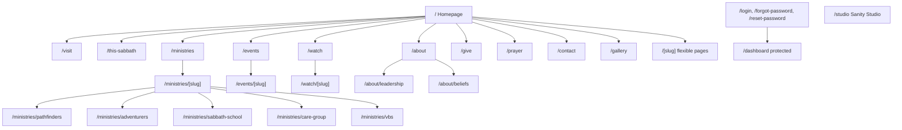

# Information Architecture

## 1. Principles

**Two doors, not one.** A first-time visitor and a 20-year member want opposite things. The visitor wants reassurance and narrative; the member wants this week's facts. The homepage narrative serves the visitor; a persistent, always-reachable "This Sabbath" serves the member. Neither is buried for the other.

**Navigation stays small.** Five primary items. A church of 274 members does not need a mega-menu. Everything else is reachable through in-page links and the footer.

**One canonical page per idea.** No "About" and "Our Story" and "Who We Are". If two pages would say the same thing, there is one page.

**Content ownership is explicit.** Every route below declares whether its content lives in Sanity, Supabase, or code. Nothing is ambiguous, because ambiguity is how a CMS ends up half-used.

---

## 2. Sitemap

Pathfinders gets a bespoke route implementation rather than the shared `[slug]` template. Everything else renders through the shared ministry template with optional extra sections. This is deliberate: Pathfinders is the flagship experience, and forcing it through a generic template would flatten it.

---

## 3. Route table

| Route                                 | Purpose                                                                                               | Rendering                      | Content source                                                               |
| ------------------------------------- | ----------------------------------------------------------------------------------------------------- | ------------------------------ | ---------------------------------------------------------------------------- |
| `/`                                   | Ten-chapter narrative homepage                                                                        | Static, revalidated by webhook | Sanity `homePage` singleton, `sabbathProgram`, `event`, `ministry`, `sermon` |
| `/visit`                              | What to expect on a first visit, directions, parking, kids, what to wear, who to ask for              | Static                         | Sanity `page`                                                                |
| `/this-sabbath`                       | Full detail for the upcoming Sabbath: program, sermon, scripture, bulletin, livestream, announcements | Static, revalidated            | Sanity `sabbathProgram`                                                      |
| `/about`                              | Mission, story, beliefs summary, conference affiliation                                               | Static                         | Sanity `page`                                                                |
| `/about/leadership`                   | Pastors, elders, ministry leaders                                                                     | Static                         | Sanity `person`                                                              |
| `/about/beliefs`                      | Adventist beliefs, in our own words, linking out to official statements                               | Static                         | Sanity `page`                                                                |
| `/ministries`                         | Interactive ministry discovery (not a card grid)                                                      | Static                         | Sanity `ministry`                                                            |
| `/ministries/[slug]`                  | Ministry detail                                                                                       | Static, `generateStaticParams` | Sanity `ministry`                                                            |
| `/ministries/pathfinders`             | Flagship immersive ministry experience                                                                | Static                         | Sanity `ministry` + `gallery` + `sermon`/video + `event`                     |
| `/events`                             | Upcoming and past events                                                                              | Static, revalidated            | Sanity `event`                                                               |
| `/events/[slug]`                      | Event detail, registration or external link                                                           | Static                         | Sanity `event`                                                               |
| `/watch`                              | Livestream state, latest message, archive                                                             | Static, revalidated            | Sanity `sermon` + `siteSettings.livestream`                                  |
| `/watch/[slug]`                       | Single message: video, speaker, scripture, notes                                                      | Static                         | Sanity `sermon`                                                              |
| `/gallery`                            | Church-wide photo and video galleries                                                                 | Static                         | Sanity `gallery`                                                             |
| `/give`                               | Why and how we give; links to AdventistGiving                                                         | Static                         | Sanity `page` + `siteSettings.givingUrl`                                     |
| `/prayer`                             | Private prayer request submission                                                                     | Dynamic (Server Action)        | Sanity `page` for copy; Supabase `prayer_requests` for data                  |
| `/contact`                            | Contact form, address, map, staff directory                                                           | Dynamic (Server Action)        | Sanity `siteSettings`; Supabase `contact_submissions`                        |
| `/[slug]`                             | Flexible editor-created pages                                                                         | Static, `generateStaticParams` | Sanity `page`                                                                |
| `/login`                              | Sign in                                                                                               | Dynamic                        | Supabase Auth                                                                |
| `/forgot-password`, `/reset-password` | Password recovery                                                                                     | Dynamic                        | Supabase Auth                                                                |
| `/auth/confirm`                       | Email link / OTP verification handler                                                                 | Route handler                  | Supabase Auth                                                                |
| `/dashboard`                          | Protected staff area (prayer queue, submissions, registrations)                                       | Dynamic, auth-gated            | Supabase                                                                     |
| `/studio/[[...tool]]`                 | Sanity Studio                                                                                         | Client, `dynamic`              | Sanity                                                                       |
| `/api/revalidate`                     | Sanity webhook receiver, signature-verified                                                           | Route handler                  | —                                                                            |
| `/sitemap.xml`, `/robots.txt`         | SEO                                                                                                   | Static, generated              | Sanity                                                                       |
| `/not-found`, `/error`                | Error states, designed not default                                                                    | Static                         | Code                                                                         |

No route is created "because sites have one." `/visit` exists because the primary audience is a nervous first-timer. `/this-sabbath` exists because members need a permalink for the thing the homepage summarizes.

---

## 4. Navigation model

**Primary navigation (5 items):** Visit · About · Ministries · Events · Watch

**Persistent right-side actions:** _This Sabbath_ (quiet, text-style, always visible — the member's shortcut) and _Give_ (the one solid button in the header).

Header behavior: transparent over the hero with light-on-dark text, transitioning to an opaque paper background with a hairline bottom rule once the hero passes. On mobile it becomes a full-height sheet with large type, service times, and address at the bottom of the sheet — because a phone user who opens the menu is often standing outside trying to figure out where to go.

**Footer** is the site's index and carries the practical payload: address with map link and directions, service times, phone, email, primary nav, ministries, Prayer, Give, Contact, social links, Southeastern California Conference attribution, and a small `/studio` staff link. Footer content comes from `siteSettings`, so staff can change a phone number once and have it change everywhere.

**Not in navigation:** Prayer, Give (button only), Gallery, Contact, individual ministries. They are reached from the homepage narrative and the footer. Prayer in particular is reached from a chapter that has earned it emotionally, not from a nav bar.

---

## 5. Content ownership boundary

The rule: **if the public should read it, Sanity owns it. If a person submitted it, Supabase owns it.** No exceptions, because exceptions are how the two systems become competing databases.

| Content                                                                                             | Owner                      |
| --------------------------------------------------------------------------------------------------- | -------------------------- |
| Homepage copy, imagery, chapter order                                                               | Sanity                     |
| Sabbath programs, sermons, announcements, bulletins                                                 | Sanity                     |
| Events, ministries, galleries, people, testimonials, resources                                      | Sanity                     |
| Service times, address, phone, social links, AdventistGiving URL, YouTube channel, livestream state | Sanity `siteSettings`      |
| SEO metadata, Open Graph images                                                                     | Sanity                     |
| Prayer requests                                                                                     | Supabase (never Sanity)    |
| Contact submissions                                                                                 | Supabase                   |
| Event and ministry registrations                                                                    | Supabase                   |
| User accounts, profiles, roles                                                                      | Supabase                   |
| Route structure, layout, motion, design tokens                                                      | Code                       |
| Secrets, project IDs, keys                                                                          | Environment variables only |

Note that the AdventistGiving URL is Sanity content, not an environment variable. It is a fact about the church that staff may need to change, not a deployment secret. Same for the YouTube channel and livestream URL. Environment variables hold only things that differ between deployments and things that must stay secret.

---

## 6. URL and SEO conventions

- Lowercase, hyphenated, no dates in slugs, no trailing slashes.
- Slugs are Sanity-authored and validated for uniqueness; changing one is a deliberate act with a redirect consequence, which we handle in `next.config.ts` if it happens.
- Every page defines title, description, canonical, and Open Graph image, defaulting from `siteSettings` when a page does not override.
- Structured data: `Church` and `Place` with `geo` and `openingHoursSpecification` on the homepage, `Event` on event pages, `VideoObject` on sermon pages, `BreadcrumbList` on nested routes. A local church lives or dies on local search; this is not optional polish.
- `sitemap.xml` is generated from Sanity so new content appears without a code change.
- `/dashboard`, `/studio`, and `/api` are excluded from indexing.
