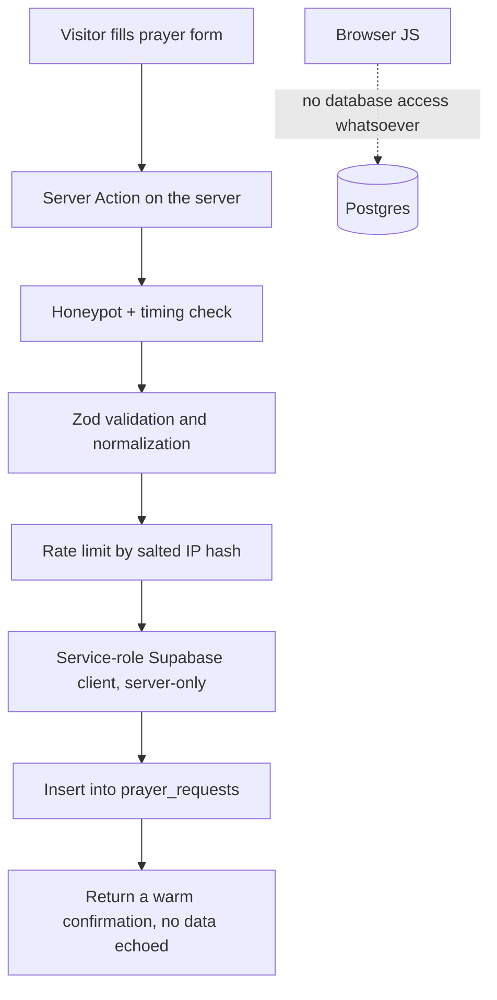

# Supabase Architecture

Supabase is the application backend: authentication, private submissions, and the data that a member or staff member owns. It is not a second CMS, and no public editorial content is stored here.

The governing assumption is that **the browser is untrusted and the client is not an authorization layer**. Every rule below follows from that.

---

## 1. Schema

All schema is defined as timestamped SQL in `supabase/migrations/`, applied with the Supabase CLI. The database is never changed only through the dashboard, because that makes the church-owned project unreproducible.

### Enums

```sql
create type app_role as enum ('member','ministry_leader','staff','admin','super_admin');
create type request_status as enum ('new','praying','answered','archived');
create type submission_status as enum ('new','in_progress','responded','archived');
create type contact_preference as enum ('none','email','phone','either');
create type registration_status as enum ('pending','confirmed','waitlisted','cancelled');
```

### Tables

**`profiles`** — one row per auth user, created by trigger on `auth.users` insert.
`id uuid primary key references auth.users(id) on delete cascade`, `full_name`, `avatar_url`, `phone`, `created_at`, `updated_at`.

**`user_roles`** — roles are rows, not a column on the profile.
`id`, `user_id references auth.users(id) on delete cascade`, `role app_role not null`, `granted_by`, `granted_at`, unique on `(user_id, role)`.

A separate table rather than `profiles.role` for three reasons: a person can hold more than one role (a ministry leader who is also staff), granting a role is auditable, and — critically — a user must never be able to update their own role. If the role lived on `profiles`, the same policy that lets a user edit their own name would let them make themselves an admin.

**`prayer_requests`** — the most sensitive table in the system.
`id uuid`, `name text` (nullable; anonymous requests have none), `email text` (nullable), `request text not null`, `is_anonymous boolean not null default false`, `contact_preference contact_preference not null default 'none'`, `status request_status not null default 'new'`, `assigned_to uuid references auth.users`, `internal_notes text`, `submitted_by uuid references auth.users` (nullable — most submissions are from signed-out visitors), `created_at`, `updated_at`, plus `ip_hash text` and `user_agent text` for abuse mitigation only. The raw IP is never stored — only a salted hash, used for rate limiting and then meaningless.

**`contact_submissions`** — `id`, `name`, `email`, `phone`, `subject`, `message`, `topic text` (which ministry or person it is for), `status submission_status`, `assigned_to`, `internal_notes`, `created_at`, `ip_hash`.

**`event_registrations`** — registrations for Sanity-authored events. `id`, `sanity_event_id text not null`, `event_title text not null` (denormalized on purpose: a registration must remain readable if the event document is later edited or deleted), `event_start timestamptz`, `name`, `email`, `phone`, `party_size int default 1`, `notes`, `status registration_status`, `user_id` (nullable), `created_at`.

**`ministry_registrations`** — Pathfinders, Adventurers, VBS. `id`, `sanity_ministry_id`, `ministry_name`, `program_year text`, `participant_name`, `participant_birthdate date`, `grade text`, `guardian_name`, `guardian_email`, `guardian_phone`, `photo_consent boolean not null default false`, `status`, `created_at`.

`photo_consent` is a database column because the media strategy depends on a real, per-child consent record rather than an assumption.

**Health and emergency information for minors is deliberately excluded from this table.** An earlier draft of this document included a `medical_notes` column; it has been removed. Collecting allergies, medications, or emergency medical detail on children is not ordinary form data, and treating it as such is how a church website acquires a liability it never intended. If the church establishes an actual operational need — a Pathfinder campout, say, where a leader must have this information in the field — it becomes a **separately threat-modeled feature** with its own decisions about encryption at rest, who may read it, retention and deletion schedule, audit logging of every read, and whether it should live in this system at all rather than on paper in a binder that a leader carries. Until that requirement is stated by the church and modeled deliberately, we do not collect it.

**`audit_log`** — deferred until the dashboard exists, then added for role grants and status changes on prayer requests.

`updated_at` is maintained by a trigger, not by application code.

---

## 2. Row Level Security

RLS is enabled on every table, with no exceptions and no "we'll add it later" tables.

### Foundation

```sql
-- Applies to every table in public.
alter table <t> enable row level security;

-- The anon and authenticated roles get no blanket grants.
revoke all on all tables in schema public from anon, authenticated;
```

Deny by default. A table with RLS enabled and no matching policy returns zero rows and rejects every write, which is the correct starting point.

### Role checking

```sql
create or replace function public.has_role(target_role app_role)
returns boolean
language sql
stable
security definer
set search_path = ''
as $$
  select exists (
    select 1 from public.user_roles
    where user_id = auth.uid() and role = target_role
  );
$$;

create or replace function public.has_min_role(target_role app_role)
returns boolean ... -- ordinal comparison over the enum
```

`security definer` with a pinned empty `search_path` is required here: without it the function is a privilege-escalation vector, and without `stable` Postgres re-evaluates it per row.

Roles are additionally injected into the JWT via a **custom access token hook**, so a Server Component can read the role from the session without a database round trip on every request. The JWT claim is a performance optimization for rendering decisions only — **every actual data access is still gated by an RLS policy that queries `user_roles`**. A stale or forged claim therefore grants nothing.

### Policy summary

| Table                    | anon     | authenticated (self)    | ministry_leader                           | staff                                  | admin / super_admin |
| ------------------------ | -------- | ----------------------- | ----------------------------------------- | -------------------------------------- | ------------------- |
| `profiles`               | none     | select/update own row   | select all                                | select all                             | select/update all   |
| `user_roles`             | none     | select own roles        | select all                                | select all                             | full — admin only   |
| `prayer_requests`        | **none** | none                    | none                                      | select, update status/assignment/notes | full                |
| `contact_submissions`    | **none** | none                    | select where topic matches their ministry | select, update                         | full                |
| `event_registrations`    | **none** | select own by `user_id` | select for their ministry's events        | select, update                         | full                |
| `ministry_registrations` | **none** | select own              | select for their ministry                 | select all                             | full                |

Two points that matter more than the rest of the table:

**`anon` has no policy at all on any table — not even insert.** Public forms do not write to the database from the browser. They post to a Server Action which uses the service-role client after validating input. This means a leaked public key gives an attacker exactly nothing, and there is no anon insert policy to reason about or accidentally widen.

**Prayer requests are never publicly readable under any circumstance.** No policy grants `anon` or plain `authenticated` any access. Even a signed-in member cannot read other people's prayer requests. This is a pastoral confidentiality requirement, not a technical preference.

Where column-level restriction is ever needed, it is done with a view that omits the column plus a policy governing access to that view. Hiding a column in the UI is not protection.

---

## 3. Public form submissions



Specifics:

- The Server Action lives in `src/lib/actions/`, is `"use server"`, and imports the admin client from `src/lib/supabase/admin.ts`, which starts with `import 'server-only'` so any accidental client import is a build failure rather than a leaked key.
- Validation with a zod schema shared between the client form (for progressive-enhancement-friendly inline errors) and the server (as the only enforcement point). Client validation is UX; server validation is security.
- Abuse mitigation without a new dependency: a hidden honeypot field, a minimum-time-to-submit check, and a database-side rate limit function keyed on the salted IP hash. If spam becomes real, we add a CAPTCHA then, not preemptively.
- Progressive enhancement: the form is a real `<form>` with a Server Action, so it works before hydration. `useActionState` adds pending state and inline errors on top.
- **No logging of prayer request bodies.** Not to the console, not to an error tracker, not to a shared email inbox. The staff dashboard is the only place the content is read. Errors log an ID, never content.
- Confirmation copy is warm and specific ("Pastor Lee and our prayer team will see this") and never echoes the submitted text back onto the page.

---

## 4. Authentication

Built on `@supabase/ssr` with the current cookie patterns.

**Three clients, three files, no exceptions.**
`src/lib/supabase/client.ts` — `createBrowserClient`, for the rare interactive client component.
`src/lib/supabase/server.ts` — `createServerClient` with Next's `cookies()`, using `getAll`/`setAll` (never the deprecated individual `get`/`set`/`remove`), for Server Components, Server Actions, and route handlers.
`src/lib/supabase/admin.ts` — service role, `server-only`, used exclusively by the public-form Server Actions.

**Middleware** refreshes the session on navigation and returns the response with updated cookies intact. It does not make authorization decisions beyond an unauthenticated redirect away from `/dashboard`, because middleware is a convenience layer — the real gate is the layout's server-side session check plus RLS.

**In Server Components, always `supabase.auth.getUser()`, never `getSession()`.** `getSession` reads a cookie that the client could have tampered with; `getUser` verifies with the auth server. This distinction is the single most common Supabase-with-Next.js security mistake.

**Routes.** `/login` (email + password), `/forgot-password`, `/reset-password`, `/auth/confirm` (a route handler that exchanges the code or verifies the OTP and redirects). No `/signup` and no public sign-up UI — sign-ups are **disabled in the Supabase project settings**, not merely absent from the interface. Accounts are created by invitation: an admin invites by email through the Admin API from a protected action, and the invitee sets a password through the recovery flow.

**Authorization** happens in three layers, in this order of trust: RLS policies in Postgres (the actual boundary), server-side checks in layouts and Server Actions (which decide what renders and what runs), and client-side conditionals (purely cosmetic). We assume the third layer is bypassable and design so that bypassing it accomplishes nothing.

**Roles at launch.** The enum and `user_roles` table ship with all five roles, and `has_role`/`has_min_role` work for all of them, so the architecture is complete. Only `staff` and `admin` are actually exercised by shipped features (the prayer queue and submissions). `member`, `ministry_leader`, and `super_admin` exist for later work and require no migration to start using — which is exactly the "architect now, build later" instruction.

**Dashboard.** `/dashboard` is one protected surface, not a CMS clone. It holds: the prayer request queue with status and assignment, contact submissions, registration lists with CSV export, and (admin only) user and role management. It deliberately contains nothing that Sanity does — no event editing, no photo uploads, no sermon entry. When a staff member asks "where do I change the homepage photo?", the answer is always Studio.

---

## 5. Storage

Private buckets only, since public editorial images live in Sanity. Anticipated: `member-documents` and `registration-attachments`, both private, both governed by storage RLS policies keyed on the owning user or a staff role. Files are served through short-lived signed URLs generated in a Server Action; no bucket is ever public and no storage URL is ever hardcoded — paths are built from `NEXT_PUBLIC_SUPABASE_URL` and a bucket constant.

---

## 6. Migration to the church-owned project

Because every schema object is a migration and no project identifier appears in source, moving projects is a credential swap:

1. Create the church-owned project. Record its ref, URL, and keys in the password manager.
2. `supabase link` to the new project, then `supabase db push` to apply all migrations in order.
3. Re-apply project settings that are configuration rather than schema: signups disabled, redirect URL allowlist, email templates, the custom access token hook, and the JWT secret rotation policy.
4. Migrate auth users via the Admin API or `supabase db dump`, **preserving UUIDs** so `profiles.id` and every `assigned_to` reference still resolves.
5. Copy Storage buckets and their policies.
6. Migrate table data with `pg_dump`/`pg_restore` scoped to `public`. Prayer requests come across as pastoral records and should be handled with the same care as paper ones.
7. Swap `NEXT_PUBLIC_SUPABASE_URL`, `NEXT_PUBLIC_SUPABASE_PUBLISHABLE_KEY`, and `SUPABASE_SECRET_KEY` in Vercel across all environments. Redeploy.
8. Verify end to end: submit a prayer request, sign in, load the dashboard, confirm RLS by attempting a read as `anon`.
9. Keep the temporary project intact and read-only for two weeks, then delete it and rotate any key that was ever shared during development.

Rehearse this once against a throwaway project before doing it for real. A migration runbook that has never been executed is a guess.
