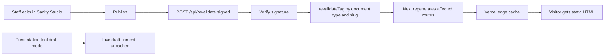

# Technical Architecture

## 1. Stack

| Layer     | Choice                          | Notes                                                             |
| --------- | ------------------------------- | ----------------------------------------------------------------- |
| Framework | Next.js 16, App Router          | Server Components by default                                      |
| Language  | TypeScript, `strict: true`      | Pinned to 5.x — see version note below                            |
| Styling   | Tailwind CSS v4                 | CSS-first config via `@theme`, no `tailwind.config.js`            |
| Motion    | Motion for React (`motion`) v13 | The only animation dependency                                     |
| CMS       | Sanity v6 + `next-sanity` v13   | Studio embedded at `/studio`, Presentation/Visual Editing enabled |
| Backend   | Supabase                        | Auth, Postgres, RLS, Storage for private files                    |
| Hosting   | Vercel                          | Node runtime, ISR via tag revalidation                            |
| Repo      | GitHub                          | Transferred to the church at handover                             |

### Version note on TypeScript

`npm view typescript version` currently returns 7.0.2 (the native compiler). We pin `typescript@^5.9` for Phase 1 because the ESLint, Sanity typegen, and editor toolchains around it are the well-trodden path, and a compiler migration is not a risk worth carrying while establishing a codebase. Revisit as a standalone task once the site is live. This is recorded so the choice does not look accidental.

---

## 2. Dependency list

Deliberately short. Every entry below has a reason; anything not listed is a "no" until a specific requirement forces it.

**Runtime**

```
next                      16.3.2
react                     19.2.8
react-dom                 19.2.8
motion                    ^13.1
@sanity/client            ^7.26.2
@sanity/image-url         ^2.1
@supabase/supabase-js     ^2.112
@supabase/ssr             ^0.12
zod                       ^4
server-only               ^0.0.1
```

Two adjustments made when Phase 0 was actually installed:

**`@sanity/client` in place of `next-sanity` until Phase 2.** `next-sanity@13.3.3` declares a peer dependency on `@sanity/client@^7.26.2`, while `sanity@6.10.1` — which `next-sanity` also requires as a peer — resolves `@sanity/client@8.2.0`. Installing `next-sanity` today therefore pulls two majors of the same client into the tree along with roughly 750 transitive packages, for capabilities (live queries, draft perspectives, Visual Editing, webhook verification) that are entirely Phase 2. `next-sanity` re-exports the same `createClient`, so adopting it later is a one-line import change in `src/sanity/lib/client.ts`. Pinning `^7.26.2` now means the eventual `next-sanity` install resolves to a single client copy.

**`@portabletext/react` deferred to Phase 2.** Nothing renders Portable Text before schemas exist, and `next-sanity` vendors `^7` internally while `^8` is current — a version choice better made when the renderer is actually written.

**`server-only` added.** It is the mechanism that makes the service-role boundary real rather than advisory: importing `lib/supabase/admin.ts` from a Client Component fails the build. Next depends on it internally, but pnpm's strict module isolation does not expose transitive dependencies, so it must be declared. Verified by deliberately importing the admin client from a client component and confirming the build fails with an import trace.

**Studio — deferred to Phase 2**

```
sanity                    ^6.10
@sanity/vision            ^6.10
```

These are **not** installed in Phase 0. A Studio with an empty schema array compiles but is usable by nobody, while pulling a large dependency tree and a heavy client route into a build we cannot meaningfully verify. Phase 0 installs `next-sanity` and `@sanity/image-url` only, which is enough to establish the client boundary, wire the project through `src/env.ts`, and verify connectivity with a `pnpm sanity:ping` script that runs one trivial GROQ query. Studio arrives in Phase 2 alongside the schemas it exists to edit.

When it does, install through the official `next-sanity` / `sanity` install path rather than by hand, so any required peer dependencies for the current major are picked up correctly instead of guessed at.

**Studio is embedded at `/studio` in this app, not standalone.** The alternative — a separate Studio project deployed to `<projectId>.sanity.studio` — was considered and rejected. Embedding keeps Presentation and Visual Editing same-origin, which means draft mode and click-to-edit work without cross-origin cookie and CORS configuration; it gives the church one deployment, one repository, and one URL to own at handover; and the Studio route is code-split, so site visitors never download it. The cost is Studio's dependency tree living in the web app's build, which is acceptable and reversible.

**Development**

```
typescript                ^5.9
@types/react @types/react-dom @types/node
tailwindcss               ^4.3
@tailwindcss/postcss      ^4.3
eslint  eslint-config-next
prettier  prettier-plugin-tailwindcss
supabase                  (CLI, for local migrations)
```

**Justifications for the two non-obvious inclusions**

- `zod` — form and environment validation. Prayer requests, contact, and registrations all accept untrusted input that must be validated server-side before touching the database. Hand-rolling that validation across four forms produces more code and more bugs than one small dependency. Also used to fail the build loudly when an environment variable is missing.
- `motion` — the entire motion system. `useScroll`, `useTransform`, `useSpring`, and `LazyMotion` give us scroll-linked and pointer-linked animation without a physics library, and tree-shake well.

**Explicitly rejected**

- **GSAP** — its scroll and timeline strengths are for choreography we are not doing. Motion for React covers scroll-linked transforms with less code and no license consideration.
- **Three.js / React Three Fiber** — a WebGL runtime for atmospheric clouds would be the single largest thing on the page. CSS gradients, layered transforms, and one or two optimized images achieve the intended effect at a fraction of the cost.
- **Lenis / smooth-scroll libraries** — smooth-scroll libraries are scroll hijacking with better manners. They break native scrollbar behavior, `scroll-behavior`, keyboard paging, and accessibility expectations. Explicitly out of scope.
- **A form library** — Server Actions plus `useActionState` plus native form validation covers our four forms.
- **A date library** — "next upcoming Sabbath" is resolved in GROQ with a date comparison, and display formatting uses `Intl.DateTimeFormat` with `timeZone: 'America/Los_Angeles'`. No `date-fns`, no `dayjs`.
- **A component library** (shadcn/ui, Radix wholesale) — the design is bespoke and card-averse; a component library would push us toward the generic look we are trying to avoid. If we later need a genuinely hard primitive (a focus-trapping dialog for the gallery lightbox), we add `@radix-ui/react-dialog` alone and document why, rather than adopting a system.
- **An icon library** — a handful of inline SVGs, hand-placed. Icon libraries invite the "random floating icons" failure mode.

Any future addition requires a line in this file explaining what it does that the existing stack cannot.

---

## 3. Rendering strategy

Static by default. The homepage, all ministry pages, events, sermons, and editorial pages are statically generated and revalidated by Sanity webhook. Nothing that a visitor sees first should wait on a network round trip at request time.



Rules:

- **Server Components by default.** A component becomes a Client Component only when it needs pointer events, scroll position, browser APIs, or local interaction state. Every `"use client"` in the codebase should be defensible in one sentence.
- **Client boundaries sit as low as possible.** A chapter section stays a Server Component that renders server-fetched content as `children` inside a thin client motion wrapper. The wrapper animates; the content stays on the server. This is the pattern that keeps an animated site from becoming a client-side app.
- **Data fetched once per route, high in the tree,** then passed down. No component fetches its own content — this is what "portability ready" means in practice.
- **Cache tags** per document type (`sabbathProgram`, `event`, `ministry`, `sermon`, `homePage`, `siteSettings`) plus per-slug tags, so publishing one event does not regenerate the whole site.
- **Draft mode** through `next-sanity`'s live/draft handling, enabled only inside the Presentation tool and gated behind a signed draft-mode route.
- `/prayer`, `/contact`, `/login`, and `/dashboard` are the only dynamic routes. They are dynamic because they write data or read a session.

---

## 4. Project structure

```
sdaClairemont/
├── docs/                             # this documentation set
├── public/
│   ├── fonts/                        # self-hosted variable fonts
│   └── og/                           # static fallback social images
├── sanity/
│   ├── schemaTypes/
│   │   ├── documents/                # one file per document type
│   │   ├── objects/                  # reusable field groups
│   │   └── index.ts
│   ├── lib/
│   │   ├── client.ts                 # configured Sanity client
│   │   ├── fetch.ts                  # sanityFetch + live query helpers
│   │   ├── image.ts                  # image URL builder + loader
│   │   └── token.ts
│   ├── queries/                      # GROQ, one file per domain
│   ├── structure.ts                  # Studio desk structure
│   ├── env.ts
│   └── sanity.types.ts               # generated by Sanity typegen, committed
├── supabase/
│   ├── migrations/                   # timestamped SQL, source of truth
│   ├── seed.sql
│   └── config.toml
├── src/
│   ├── app/
│   │   ├── (site)/                   # public site, shares header/footer
│   │   │   ├── layout.tsx
│   │   │   ├── page.tsx              # homepage
│   │   │   ├── visit/ this-sabbath/ about/ ministries/ events/
│   │   │   ├── watch/ gallery/ give/ prayer/ contact/
│   │   │   └── [slug]/               # flexible pages
│   │   ├── (auth)/                   # login, forgot-password, reset-password
│   │   ├── (dashboard)/              # protected, own chrome
│   │   ├── studio/[[...tool]]/
│   │   ├── api/revalidate/
│   │   ├── auth/confirm/
│   │   ├── layout.tsx                # fonts, html lang, base metadata
│   │   ├── sitemap.ts
│   │   └── robots.ts
│   ├── components/
│   │   ├── ui/                       # button, link, field, dialog, rule, eyebrow
│   │   ├── layout/                   # header, footer, nav, mobile sheet, skip link
│   │   ├── sections/                 # homepage chapters and page sections
│   │   ├── motion/                   # motion primitives (see MOTION-SYSTEM.md)
│   │   ├── media/                    # image, gallery, lightbox, youtube embed
│   │   ├── ministries/               # ministry switcher, pathfinder-specific
│   │   └── forms/                    # prayer, contact, registration forms
│   ├── lib/
│   │   ├── supabase/
│   │   │   ├── client.ts             # browser client
│   │   │   ├── server.ts             # RSC / Server Action client
│   │   │   ├── admin.ts              # service-role, server-only
│   │   │   └── middleware.ts         # session refresh helper
│   │   ├── actions/                  # Server Actions, one per form
│   │   ├── schemas/                  # zod schemas shared by forms and actions
│   │   ├── sabbath.ts                # next-Sabbath resolution, TZ-aware formatting
│   │   ├── seo.ts                    # metadata + JSON-LD builders
│   │   └── utils.ts
│   ├── config/
│   │   └── site.ts                   # non-secret build-time constants
│   ├── styles/
│   │   └── globals.css               # @theme tokens, base layer, motion tokens
│   ├── types/
│   └── env.ts                        # zod-validated environment access
├── middleware.ts
├── next.config.ts
├── postcss.config.mjs
└── .env.example
```

Folders are created when first needed, not upfront. `src/components/ministries/` does not exist until the ministry switcher does.

---

## 5. Environment and portability

The hard rule: **no project URL, key, project ID, dataset name, storage URL, or database identifier appears in source.** Everything flows through `src/env.ts`.

```
# App — always required
NEXT_PUBLIC_SITE_URL=

# Sanity — required from Phase 2
NEXT_PUBLIC_SANITY_PROJECT_ID=
NEXT_PUBLIC_SANITY_DATASET=
NEXT_PUBLIC_SANITY_API_VERSION=
SANITY_API_READ_TOKEN=                  # viewer token, drafts only, server-only
SANITY_REVALIDATE_SECRET=               # webhook signature secret, server-only

# Supabase — required from Phase 5
NEXT_PUBLIC_SUPABASE_URL=
NEXT_PUBLIC_SUPABASE_PUBLISHABLE_KEY=   # sb_publishable_… browser-safe
SUPABASE_SECRET_KEY=                    # sb_secret_… server-only, bypasses RLS
```

### Validation is lazy and grouped, not a single top-level parse

A single `z.object({...}).parse(process.env)` at module load cannot satisfy two requirements we both have: fail loudly when a variable is genuinely missing, _and_ let the repository install and build before Phase 2 and Phase 5 services are configured. It also breaks CI, which has no credentials at all.

So `src/env.ts` exposes **three memoized accessor functions** rather than one eagerly-parsed object:

- `appEnv()` — always required. `NEXT_PUBLIC_SITE_URL`, defaulted to `http://localhost:3000` in development.
- `sanityEnv()` — parsed on first call, which only happens when a Sanity module is actually used.
- `supabaseEnv()` — same, split so that the server-only secret is read by a separate `supabaseSecretEnv()` that is never reachable from a client module.

Each throws a readable, actionable message naming the missing variable and the phase it belongs to. The result: `pnpm install`, `pnpm typecheck`, `pnpm lint`, and `pnpm build` all succeed on a clean checkout with no `.env.local` at all, and CI needs no secrets — while a route that genuinely requires Sanity still fails immediately and clearly. This is the difference between validation that helps and validation that blocks.

Conventions that make the eventual handover mechanical rather than archaeological:

- `NEXT_PUBLIC_` prefix only where the browser genuinely needs the value. The service-role key is imported exclusively from `src/lib/supabase/admin.ts`, which begins with `import 'server-only'` so a mistaken client import fails at build time instead of leaking at runtime.
- Church-specific facts (AdventistGiving URL, YouTube channel, phone, address) live in Sanity, not in environment variables. They are content that staff should be able to change.
- Truly static, non-secret constants (route paths, default locale, timezone `America/Los_Angeles`) live in `src/config/site.ts`.
- Images are rendered through the Sanity image URL builder from `sanity/lib/image.ts`; no component ever constructs a CDN URL. If the Sanity project changes, exactly one file's inputs change.
- Supabase is reached only through the three clients in `src/lib/supabase/`. No component imports `@supabase/supabase-js` directly.
- Database schema lives in `supabase/migrations/` as timestamped SQL, applied via the Supabase CLI. The database is never modified only through the dashboard, because that makes it unreproducible in a new project.

### Migration runbooks

**Supabase, temporary project to church-owned.** Create the new project. Run `supabase db push` against it to apply every migration in order. Export and import auth users via the Admin API or `supabase db dump`, preserving UUIDs so `profiles.id` foreign keys still resolve. Copy any Storage buckets. Re-apply auth settings: signups disabled, redirect URL allowlist, email templates. Swap the three Supabase environment variables in Vercel. Redeploy. Verify by submitting a prayer request and signing in. The temporary project stays read-only for two weeks before deletion. Because all schema is migration-based and nothing references the project ref in code, this is a credential swap, not a rewrite.

**Sanity, to church-owned.** Create the new project and dataset. `sanity dataset export` from the old, `sanity dataset import` into the new — this carries documents and assets together. Re-add CORS origins for the production domain and localhost. Re-create the webhook pointing at `/api/revalidate` with the new secret. Invite staff and set roles. Swap the Sanity environment variables. Rerun typegen and commit. Asset URLs change because they embed the project ID, which is exactly why no asset URL is ever hardcoded.

**Vercel and GitHub.** Transfer the GitHub repository to the church organization. Transfer the Vercel project to the church's Vercel team, or re-import from the transferred repo and copy environment variables per environment. Move the domain into the church's Vercel or point DNS at it. Re-issue the Sanity webhook against the production URL if it changed. Verify preview deployments still build.

**Handover checklist.** The church should end up owning: GitHub repo, Vercel project and domain, Supabase project, Sanity project, analytics property, YouTube channel, and AdventistGiving account — with at least two staff members holding admin on each, and credentials in a shared password manager rather than one person's inbox.

---

## 6. Security posture

- Row Level Security enabled on every Supabase table, with deny-by-default policies. No table is readable by `anon`.
- All writes from public forms go through Server Actions. The browser never holds a token that can write to the database.
- Authorization is enforced in Postgres policies, with UI checks treated purely as ergonomics. A user who forges a client-side role gains nothing.
- Sanity write tokens exist only in Studio sessions (real user logins). The application's server token is read-only.
- The revalidation webhook verifies its signature before doing any work.
- Content Security Policy with a nonce, allowing the YouTube and Sanity CDN origins we actually use. Applied after the visual work settles, since a strict CSP interacts with Studio.
- Prayer request content is treated as pastorally confidential: no logging of request bodies, no analytics on that route beyond a pageview, no email of full content to a shared inbox.

---

## 7. Quality gates

Tooling specifics that are easy to get wrong on this particular stack:

- **ESLint** uses the flat config (`eslint.config.mjs`) that `create-next-app` now scaffolds. `next lint` no longer exists in Next 16, so the `lint` script invokes `eslint` directly.
- **Prettier** with `prettier-plugin-tailwindcss` needs the Tailwind v4 `tailwindStylesheet` option pointing at `src/styles/globals.css`. The older `tailwindConfig` option does nothing in v4, and class sorting silently fails without it.
- **`pnpm format` runs once at scaffold time**, because `create-next-app` output is not Prettier-clean and `format:check` would otherwise fail on generated files.
- **Node and pnpm are pinned** via `engines` and `packageManager` in `package.json` plus `.nvmrc`. Vercel reads `engines.node`.

Gates:

- `pnpm typecheck`, `pnpm lint`, `pnpm format:check`, `pnpm build` pass on every pull request via GitHub Actions, with **no credentials configured** — which is only possible because environment validation is lazy.
- Sanity typegen output is committed, so a schema change that breaks a query fails typecheck rather than production.
- Lighthouse CI on the homepage and `/ministries/pathfinders` (the heaviest page), with budgets from `MOTION-SYSTEM.md`.
- Accessibility: automated `axe` pass, plus a manual keyboard-only walkthrough of the homepage, ministry switcher, and gallery lightbox before each phase is called done.
